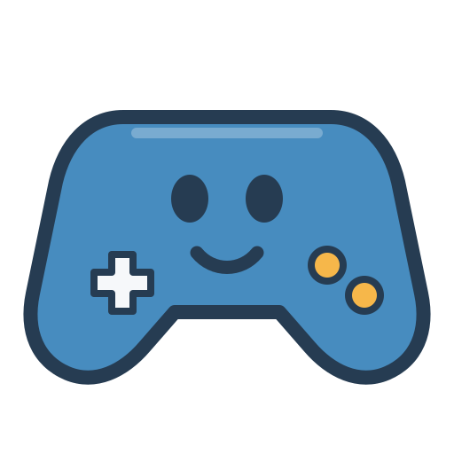

<p align="center">
  
</p>

<h1 align="center">GodoPilot</h1>

<p align="center"><strong>Build games with AI, directly in the Godot editor.</strong></p>

<p align="center">
  An open source MCP bridge for Claude Code and Codex CLI.
  Inspect your game, change scenes and scripts, run it, and verify the result without leaving your project.
</p>

<p align="center">
  <a href="#install">Install</a> ·
  <a href="#what-you-can-do">What you can do</a> ·
  <a href="#how-it-works">How it works</a> ·
  <a href="docs/cookbook.md">Examples</a> ·
  <a href="docs/installation.md">Documentation</a>
</p>

GodoPilot connects an AI coding client to the **Godot 4.3+** editor. It gives the assistant tools for scenes, nodes, GDScript, assets, 2D and 3D workflows, playtesting, and project inspection. The editor remains the source of truth: the AI can make a change, run the game, inspect errors or screenshots, and refine it.

> GodoPilot is an independent community project for Godot Engine. It is not affiliated with or endorsed by the Godot project.

## Install

You need **Godot 4.3+**, **Node.js 22.12+ with npm**, and **Claude Code or Codex CLI**. Open a terminal in your **game project folder** (where `project.godot` lives), then run:

**macOS / Linux**

```sh
curl -fsSL https://raw.githubusercontent.com/joaoviitorsx/godot-devpilot-mcp/main/install.sh | sh
```

**Windows PowerShell**

```powershell
irm https://raw.githubusercontent.com/joaoviitorsx/godot-devpilot-mcp/main/install.ps1 | iex
```

The installer adds the Godot editor plugin and a local MCP runtime to this game, enables the plugin, configures the clients it finds, and adds short project guidance for the AI. Existing client instructions are preserved.

**Then:**

1. Open the game project in the Godot editor.
2. Start a new Claude Code or Codex CLI session in the same game folder.
3. Ask: **“Use GodoPilot to inspect this game and suggest the next playable improvement.”**

To verify the editor connection, run `node .godot_mcp/runtime/doctor.mjs` from the game folder. For updates, manual setup, troubleshooting, and installer options such as `--read-only` or `--client codex`, see the [installation guide](docs/installation.md).

## What you can do

| Goal | How GodoPilot helps |
| --- | --- |
| Understand an existing game | Summarize scenes, scripts, dependencies, input actions, signals, and project structure. |
| Build a playable feature | Add or edit nodes, scenes, GDScript, resources, UI, and input mappings, then run checks. |
| Make 2D and 3D games | Use focused helpers for characters, cameras, lighting, navigation, animations, audio, shaders, tiles, and GridMap. |
| Work with assets | Inspect imported resources, assign materials, import glTF scenes, and audit 3D models. |
| Verify behavior | Run the game, collect logs, capture screenshots, simulate input, assert properties, and run headless tests. |
| Stay in control | Preview changes with dry run, work in read only mode, use backups, and undo supported editor actions. |

The AI can find relevant tools with `devpilot_find_tools` instead of scanning the full catalog. Start with `devpilot_game_context` for a project overview; use `godot_get_capabilities` when you need the exact active tool list. [Browse the full reference](docs/api_reference.md).

### Prompts to try

```text
Inspect this Godot project. Find the main scene, controls, current gameplay loop,
and the smallest next feature that would make it more playable.
```

```text
Create a third-person 3D prototype with a controllable character, follow camera,
lighting, collision, and a test arena. Run it and report what you verified.
```

```text
Add a 2D level with TileMapLayer, player movement, an enemy, and a win condition.
Use my existing assets where possible, then playtest the result.
```

For an unfamiliar genre, ask the assistant to use `devpilot_game_production_loop` with your concept and build one verified playable slice at a time. For a ready 3D starting point, `devpilot_create_3d_starter` supports FPS and TPS scenes. The [cookbook](docs/cookbook.md) has longer examples.

## How it works

```text
Claude Code / Codex CLI
        │ MCP
        ▼
GodoPilot server (local Node.js process)
        │ authenticated WebSocket on 127.0.0.1
        ▼
GodoPilot plugin inside the Godot editor
        ▼
Your game project
```

The bridge runs locally, checks the project path and protocol version, and uses a per project token. Mutating tools support project path checks; many support dry run, backup, or Godot UndoRedo. Read the [security model](docs/security.md) for the exact guarantees and exceptions.

The installer defaults to the `full` tool profile. You can choose `minimal`, `core`, or `agentic` according to the work you want the AI to do. Optional integrations include [Better Tile Editor](docs/better_tile_editor.md) for advanced tiles on Godot 4.6+ and GUT for tests.

GodoPilot has broad editor coverage, but it does **not** implement every Godot API or a dedicated workflow for every game genre. Multiplayer, vehicles, and rhythm systems currently rely on composition from general tools and project code. See the [current coverage audit](docs/quality_audit_2026-10-24.md) and [engine coverage plan](docs/engine_coverage_plan.md).

## For contributors

This repository is the plugin development workspace; its `project.godot` was saved with Godot 4.6. The installed addon targets Godot 4.3+ for its core tools.

```sh
cd mcp-server
npm ci
npm run build
npm test
```

The server lives in `mcp-server/`; the editor plugin lives in `addons/godot_devpilot_mcp/`. For local evaluation and releases, see the [testing guide](docs/MANUAL_TESTING_GUIDE.md), [contribution guide](docs/contributing.md), [implementation status](docs/IMPLEMENTATION_PROGRESS.md), and [changelog](CHANGELOG.md). The [brand assets](logos/preview.html) include the selected controller mascot and two explored concepts.

## License

MIT — see [LICENSE](LICENSE).
